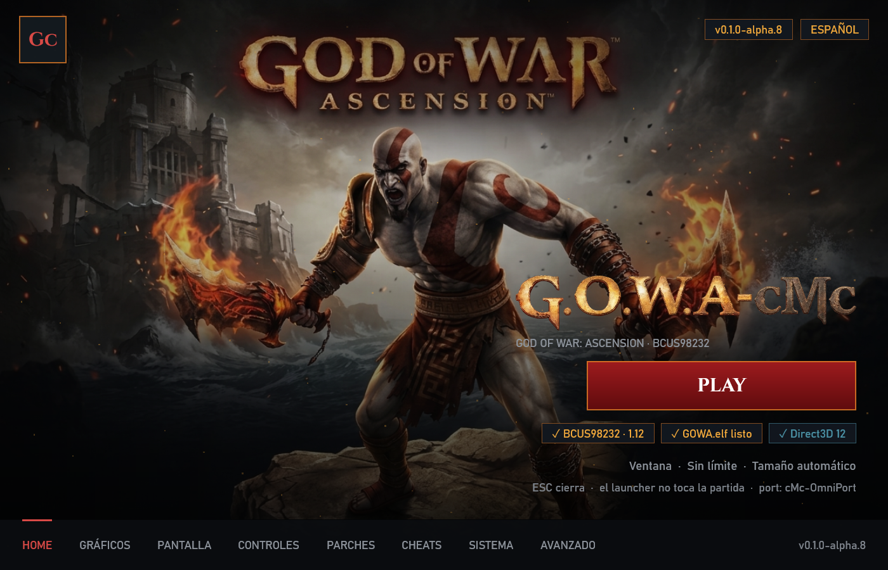
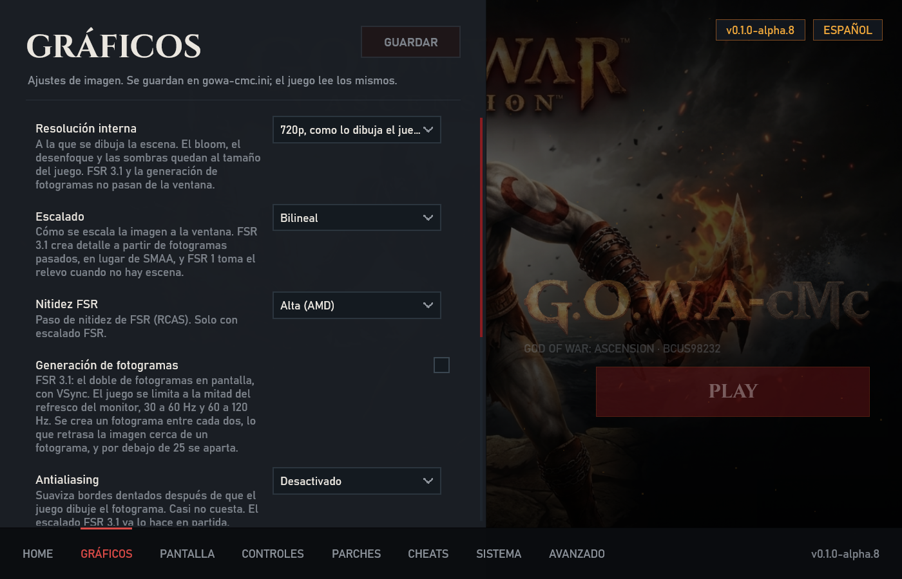
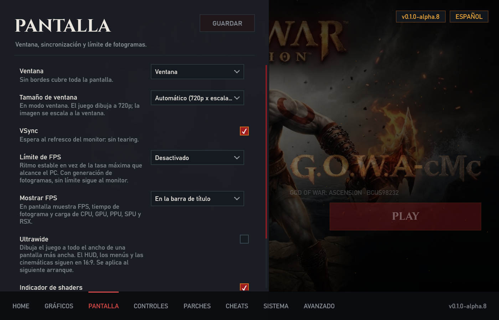
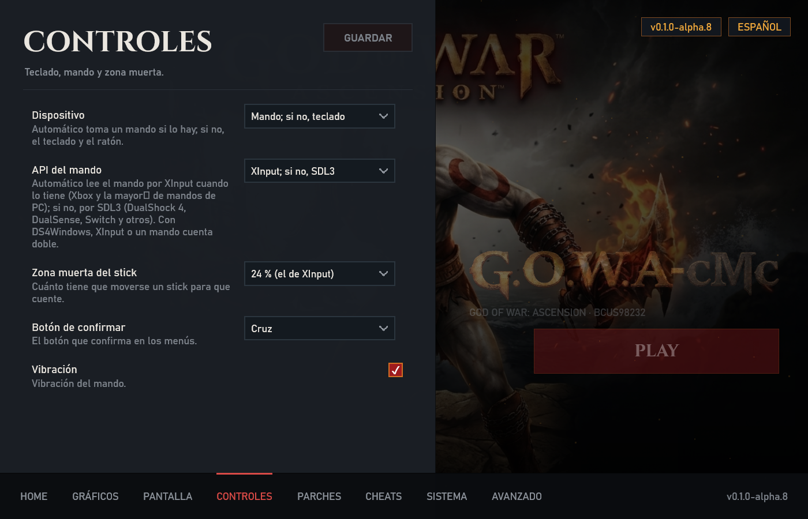
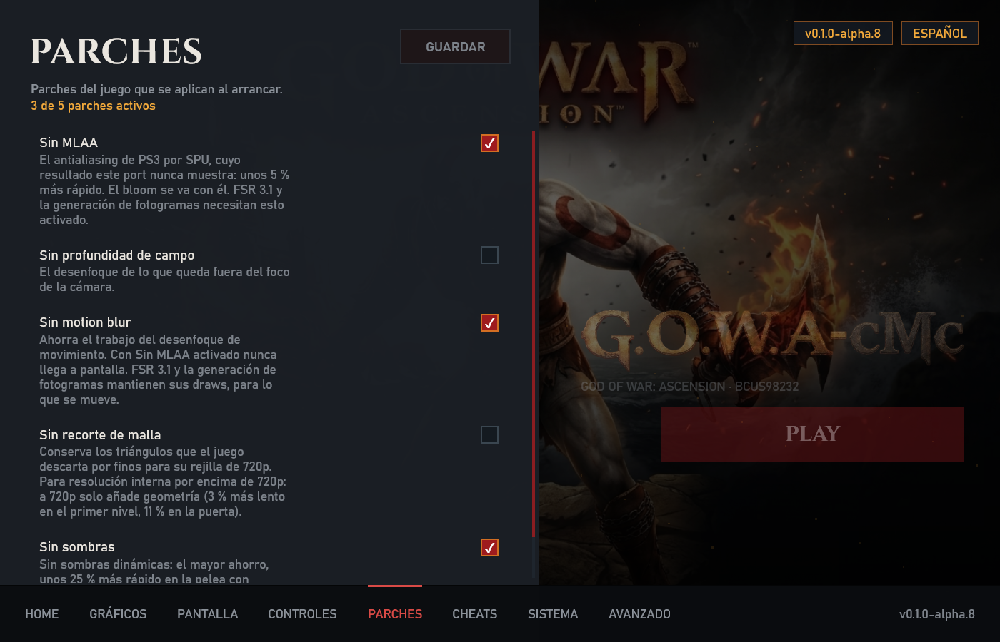
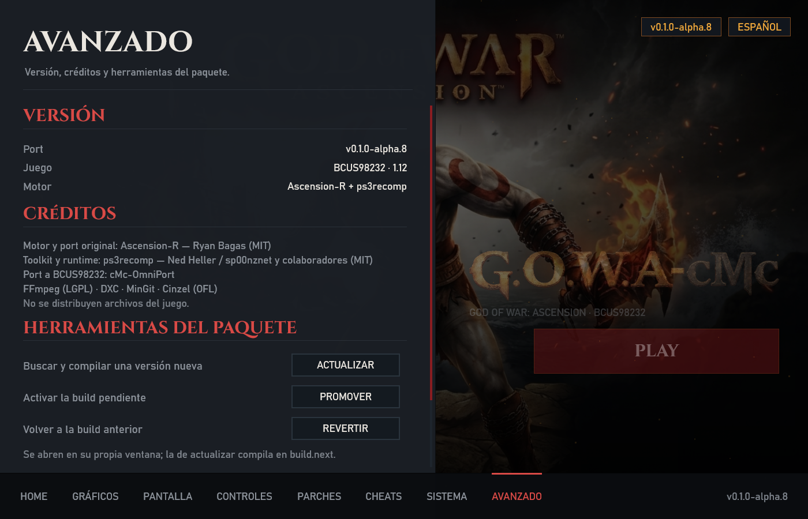

<p align="center">
  
</p>

<div align="center">

# GOWA_cMc_OmniPort

**God of War: Ascension · BCUS98232 · Windows x64**


</div>

Port nativo de **God of War: Ascension** (PS3, BCUS98232) para Windows x64,
hecho con recompilación estática mediante [ps3recomp](https://github.com/sp00nznet/ps3recomp).
El código PPU y SPU se traduce a x86-64 y el RSX se dibuja con Direct3D 12:
no hay emulador durante la partida. RPCS3 se usa solo para descifrar tu copia.

Repositorio: <https://github.com/cMc292/GOWA_cMc_OmniPort>

> [!IMPORTANT]
> Este repositorio no contiene archivos del juego. El port se construye y se
> ejecuta con tu propia copia legítima. Consulta [Legal](#legal).

<a href="https://recomplauncher.com/game/gowa-cmc-omniport"><picture><source media="(prefers-color-scheme: dark)" srcset="https://recomplauncher.com/assets/press/launcher/badge-light.svg"></picture></a>

## Contenido

- [Estado](#estado)
- [Características](#características)
- [Descarga](#descarga)
- [Requisitos](#requisitos)
- [Primera ejecución](#primera-ejecución)
- [Compilar desde el código](#compilar-desde-el-código)
- [Mods](#mods)
- [Controles](#controles)
- [Informes de problemas](#informes-de-problemas)
- [Cómo funciona](#cómo-funciona)
- [Estructura del proyecto](#estructura-del-proyecto)
- [Preguntas frecuentes](#preguntas-frecuentes)
- [Legal](#legal)
- [Créditos](#créditos)
- [Licencia](#licencia)

## Estado

- **Juego:** God of War: Ascension **BCUS98232 1.12**, con su Update.
- **Plataforma:** Windows 10 u 11, 64 bits.
- **GPU:** compatible con Direct3D 12.
- **Online:** no soportado; el port es para un jugador.
- **Primera carga:** compila los shaders del juego; puede tardar varios minutos.
- **Paquete:** portable, sin instalador; la configuración, los logs y el caché
  quedan junto al ejecutable gracias a `portable.txt`.

## Características

- **Launcher cMc:** páginas de gráficos, pantalla, controles, parches, cheats,
  mods, sistema, avanzado, log y trofeos.
- **Idiomas:** launcher en inglés, español, portugués de Brasil, francés,
  alemán e italiano; cambio en caliente al pulsar **GUARDAR**.
- **Juego:** idioma limitado a los idiomas reales del disco.
- **Imagen:** FSR, SMAA, filtrado anisotrópico, vibrance y contraste.
- **Pantalla:** ventana, borderless, ultrawide, VSync, límite de FPS y panel GC.
- **Shaders:** compilación con DXC y caché persistente.
- **Parches:** MLAA, profundidad de campo, motion blur, sombras y mesh trimming.
- **Cheats:** daño, orbes, magia, objetos, furia y dobles saltos.
- **Controles:** Xbox/XInput y PlayStation mediante SDL3; teclado y ratón.
- **Mods:** carpeta `mods` funcional; mods por carpeta o `.zip`.
- **Guardados:** copias de seguridad antes de sobrescribir.
- **Informes:** `GOWA-cMc.exe --report` genera un ZIP con los logs y las rutas
  ocultas.

## Capturas

| | |
|---|---|
| **HOME**<br> | **GRÁFICOS**<br> |
| **PANTALLA**<br> | **CONTROLES**<br> |
| **PARCHES**<br> | **AVANZADO**<br> |

## Descarga

La página de releases publica el paquete portable. No contiene `PS3_GAME`,
`*.psarc`, `EBOOT`, vídeos, trofeos, claves ni licencias de la consola.

Cada release incluye:

```text
portable.txt
mods\skip-intro
kit\python + kit\scripts\modpack.py
AVISO-LEGAL.txt
```

No incluye `GOWA.elf`: se genera en la primera ejecución.

### RecompLauncher

[](https://recomplauncher.com/game/gowa-cmc-omniport)

También puedes instalar y actualizar el Release desde
[RecompLauncher](https://recomplauncher.com/game/gowa-cmc-omniport).
El paquete incluye `recomplauncher.json` para esa integración.

## Requisitos

- Windows 10 u 11, 64 bits.
- CPU con AVX2 y FMA.
- GPU compatible con Direct3D 12.
- Tu copia legítima de **BCUS98232 1.12** con el Update `1.04–1.12`.
- RPCS3 para descifrar la primera vez, o tu propio `GOWA.elf`.

## Primera ejecución

1. Extrae el ZIP en una **ruta corta** (`C:\GOWA`, el Escritorio).
   Evita rutas profundas: Windows y el juego tienen un límite práctico de
   260 caracteres.
2. Ejecuta `GOWA-cMc.exe`.
3. En **SISTEMA**, elige la carpeta que contiene **`PS3_GAME`**.
   No elijas `Update\BCUS98232`: no tiene `ARCHIVES`.
4. El launcher busca el Update y descifra `GOWA.SELF` con RPCS3.
5. Deja terminar **COMPILANDO SHADERS**.
6. Cuando HOME muestre `GOWA.elf listo`, pulsa **PLAY**.

Si ya tienes un `GOWA.elf`, usa **USAR GOWA.ELF...** en SISTEMA.

## Compilar desde el código

Requisitos de compilación: Git, CMake, Ninja, Visual Studio con el compilador
C++ de Clang para Windows, Windows SDK, Python y FFmpeg compartido en `_src\ffmpeg`.

```powershell
$env:GOWA_ELF = "$PWD\GOWA.elf"
tools\python\python.exe scripts\gowa.py build --jobs 8
```

El ejecutable sale en `build\GOWA-cMc.exe`. Consulta
[BUILD.md](BUILD.md) para las dependencias locales y el empaquetado.

## Mods

El port lee la carpeta `mods` situada junto a la configuración. Un mod puede ser
una carpeta o un `.zip`; el launcher lo lista en **MODS**, donde se activa,
desactiva y ordena.

Formato admitido:

```text
mod.ini
archive\...
USRDIR\...
```

El paquete incluye `skip-intro` convertido a este formato, con dos entries
`BOOT_*.TXT` vacíos. Los mods son solo archivos: no se ejecuta código de un mod.

## Controles

| Tecla | Acción |
|---|---|
| `F10` | Mostrar u ocultar el panel GC |
| `F11` | Ventana / borderless |
| `F12` | Captura de pantalla |
| `F9` | Releer texturas |
| `ESC` | Cerrar el juego, si está activado en SISTEMA |

## Informes de problemas

`GOWA-cMc.exe --report` genera un ZIP con los logs, la configuración y los datos
del sistema. Las rutas, el usuario y el nombre del PC se ocultan. No se incluye
ningún archivo del juego.

## Cómo funciona

1. `gowa.py lift` traduce el código PPU de `GOWA.elf` a C++; el build hace lo
   mismo con los programas SPU y los job modules.
2. El runtime de [ps3recomp](https://github.com/sp00nznet/ps3recomp) sustituye
   a la PS3: syscalls, bibliotecas, SPURS, sistema de archivos, audio, mandos y
   guardados.
3. Los comandos RSX se dibujan con Direct3D 12; los shaders se traducen a HLSL
   y se compilan con DXC.
4. Las cinemáticas se decodifican con FFmpeg.
5. El código SPU no traducido se ejecuta en un intérprete; la sesión lo registra
   y el siguiente `lift` lo incorpora.

## Estructura del proyecto

```text
port/          entrada, launcher y código específico del juego
recompiled/    código PPU traducido
spu/           programas SPU traducidos
ps3recomp/     toolkit y runtime de ps3recomp
scripts/       gowa.py, empaquetado y utilidades
tools/         Python local y herramientas de build
tests/         pruebas del launcher, del juego y del empaquetado
docs/          análisis, bitácora, i18n y notas
_src/          FFmpeg y SDL3 locales
locale/        textos del launcher
```

## Preguntas frecuentes

### ¿Es una versión oficial de PC?

No. *God of War: Ascension* solo salió en PlayStation 3. Este es un proyecto
de aficionados, sin ánimo de lucro y no afiliado a Sony.

### ¿Necesito el juego original?

Sí. El paquete no contiene código ni archivos del juego. Necesitas una copia
legítima de BCUS98232 1.12 y su Update.

### ¿Por qué el paquete no incluye `GOWA.elf`?

Porque es código derivado del juego. El launcher lo genera desde tu `GOWA.SELF`
con RPCS3 y tu copia legal.

### ¿RPCS3 es necesario para jugar?

No. Solo se usa para descifrar la primera vez. Después, el juego se ejecuta
nativo con Direct3D 12.

### ¿Puedo usar mods?

Sí. La carpeta `mods` está incluida y es funcional. Añade carpetas o `.zip` y
actívalos en MODS.

### ¿Por qué tarda la primera vez?

Porque compila los shaders del juego. Es un proceso único por versión; después
se usa el caché generado.

## Legal

Aviso legal

Este release no contiene archivos del juego: ni PS3_GAME, ni *.psarc, ni EBOOT, ni vídeos, ni trofeos, ni claves o licencias de la consola.

El ejecutable contiene código traducido del juego, obra derivada de God of War: Ascension: se ofrece para usarse con una copia legítima y la licencia MIT del proyecto no la cubre.

God of War es una marca de Sony Interactive Entertainment LLC / Santa Monica Studio. Proyecto de aficionados, sin ánimo de lucro, no afiliado a Sony.

## Créditos

- **Ascension-R** — port original y motor:
  <https://github.com/rigaz29/Ascension-R>
- **ps3recomp** — toolkit y runtime de PS3:
  <https://github.com/sp00nznet/ps3recomp>
- **cMc-OmniPort** — adaptación a BCUS98232, launcher y traducciones:
  <https://github.com/cMc292/GOWA_cMc_OmniPort>
- **FFmpeg** (LGPL), **SDL3** (zlib), **DXC** (MIT), **zlib**, **Cinzel**
  (SIL OFL) y runtime de Microsoft.
- **RecompLauncher** — manifiesto de integración:
  <https://recomplauncher.com>

Lee `CREDITOS.md`, `LICENSE` y `THIRD_PARTY_NOTICES.md` antes de redistribuir.
## Licencia

El código del proyecto está bajo la licencia **MIT**; consulta `LICENSE`.
La licencia MIT **no cubre** el juego ni el código derivado de él.
