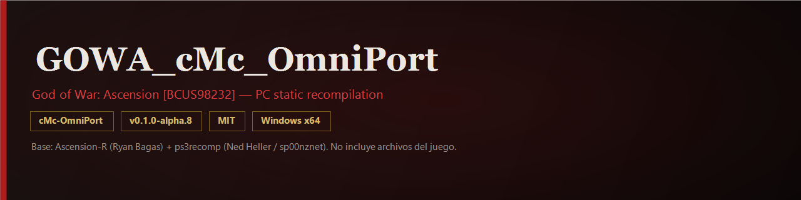

<p align="center">
  
</p>

# GOWA_cMc_OmniPort

**God of War: Ascension [BCUS98232] — port nativo a Windows x64 por recompilación estática.**
Adaptación a la **versión de disco US (`BCUS98232`) v1.12** por **cMc-OmniPort**, sobre
[Ascension-R](https://github.com/rigaz29/Ascension-R) de **Ryan Bagas** y
[ps3recomp](https://github.com/sp00nznet/ps3recomp) de **Ned Heller (sp00nznet)** y colaboradores.

[](https://github.com/cMc292/GOWA_cMc_OmniPort/releases)
[](LICENSE)


> [!IMPORTANT]
> **Este proyecto no contiene archivos del juego**: ni `PS3_GAME`, ni `*.psarc`, ni `EBOOT`, ni vídeos, ni trofeos.
> Para jugar necesitas **tu propia copia** de *God of War: Ascension* `BCUS98232` v1.12 (disco + parches 1.04–1.12)
> y su `GOWA.elf` descifrado.
>
> El **ejecutable del paquete sí contiene código traducido del juego**: es una obra derivada, la licencia MIT de este
> repositorio **no** la cubre, y sigue perteneciendo a sus titulares. Léelo en el [aviso legal](#aviso-legal).

## Contenido

- [Qué es](#qué-es)
- [Estado](#estado)
- [Características](#características)
- [Descarga](#descarga)
- [Requisitos](#requisitos)
- [Instalación](#instalación)
- [Apuntar el port a tu copia del juego](#apuntar-el-port-a-tu-copia-del-juego)
- [Actualizar el port](#actualizar-el-port)
- [Launcher y ajustes](#launcher-y-ajustes)
- [Estructura del paquete](#estructura-del-paquete)
- [Limitaciones conocidas](#limitaciones-conocidas)
- [Cómo reportar un problema](#cómo-reportar-un-problema)
- [Créditos](#créditos)
- [Licencia](#licencia)
- [Aviso legal](#aviso-legal)
- [English summary](#english-summary)

## Qué es

El código de la PS3 (`GOWA.SELF`: PPU y SPU) se traduce **antes de jugar** a x86-64 con
[ps3recomp](https://github.com/sp00nznet/ps3recomp) y el RSX se dibuja con **Direct3D 12**: mientras juegas no hay
emulador. [Ascension-R](https://github.com/rigaz29/Ascension-R) hizo ese trabajo para la versión **digital US
`NPUA80918` 1.12**; este proyecto lo adapta a la **versión de disco US `BCUS98232` 1.12**.

El port a BCUS se apoya en un hecho comprobado: el `GOWA.elf` de `BCUS98232` 1.12 y el de `NPUA80918` 1.12 son **el
mismo ejecutable** (mismo SHA-256), así que se puede reutilizar el lift del port original en vez de levantar el juego
otra vez. Lo que cambia es el resto del pipeline:

- vista fusionada **disco + parches 1.04–1.12** (los archivos son los de tu copia, enlazados: no se duplican);
- identidad `BCUS98232` en la búsqueda del juego, el launcher y `game_files.inc`;
- descifrado del `GOWA.SELF` de parche (NPDRM) mediante el **KLIC** del parche 1.12;
- empaquetado **portable** con lanzadores nativos, FFmpeg, MinGit y Python embebido, y **modo de actualización**
  (`Update` / `Promote` / `Rollback`).

Documentación del trabajo: [`docs/`](docs/).

## Estado

**alpha.** Arranca, reproduce las cinemáticas, pasa por los menús y entra en los niveles; **no** se ha jugado de
principio a fin. El paquete `v0.1.0-alpha.8` de este repositorio se probó con un *smoke test* de 180 s tras cada
build (entry OPD `0x8283F8`, backend Direct3D 12, `libavcodec` decodificando, ~41 000 draws por sesión) y con
sesiones manuales en el launcher.

| | |
|---|---|
| Juego | *God of War: Ascension*, **disco US `BCUS98232` v1.12** (disco + parches 1.04–1.12) |
| Base | Ascension-R **v0.1.0-alpha.8** (`e2d5d31`) + adaptación BCUS |
| Plataforma | Windows 10/11, 64 bits |
| Render | Direct3D 12 (RSX → D3D12) |
| Online | **no soportado** (el port es de un jugador) |
| Multijugador | no probado |
| Estado | alpha, sin garantías |

## Características

### El juego

- **Recompilación estática**: PPU → C++, SPU → C, sin emulador en tiempo de ejecución.
- **RSX → Direct3D 12**, con los shaders traducidos a HLSL y compilados con DXC.
- **Cinemáticas y audio comprimido** con FFmpeg (LGPL, DLLs compartidas incluidas).
- **SPURS y job modules** traducidos; lo que no se tradujo a tiempo corre en intérprete y se añade al siguiente lift.

### Launcher

La interfaz del port (estilo *SpartanPort*, con la paleta de *Ascension* y textos en español) tiene **diez páginas**:

**HOME · GRÁFICOS · PANTALLA · CONTROLES · PARCHES · CHEATS · SISTEMA · AVANZADO · LOG · TROFEOS**

- **HOME**: arte de fondo a sangre (tu imagen o el fondo procedural), wordmark, **PLAY**, presets
  *Suave / Equilibrado / Fieles*, chips de estado (copia del juego, `GOWA.elf`, GPU) y resumen de la sesión.
- **GRÁFICOS**: resolución interna 1×–4× o nativa, escalado AMD FSR 1 y FSR 3.1, generación de fotogramas FSR 3.1,
  SMAA 1×, filtrado anisotrópico, caché de shaders comprimida.
- **PANTALLA**: ventana o sin bordes, ultrapanorámica, VSync, límite de FPS, indicador de FPS y carga en pantalla.
- **CONTROLES**: mando o teclado y ratón; XInput y, por SDL3, DualShock 4, DualSense, mandos de Switch y otros;
  zona muerta, botón de confirmar, vibración, API del mando.
- **PARCHES**: MLAA, profundidad de campo, desenfoque de movimiento, recorte de mallas, sombras dinámicas.
- **CHEATS**: daño recibido y hecho, orbes rojos, magia y objetos infinitos, furia infinita, doble salto.
- **SISTEMA**: carpeta del juego, `GOWA.elf`, comprobar actualizaciones, informe de problemas, versión.
- **AVANZADO**: ajustes finos y herramientas del paquete.
- **LOG**: el registro de la última sesión, con scroll.
- **TROFEOS**: la lista completa leída del `TROPHY.TRP` del juego (icono, nombre, descripción y
  PLATINO/ORO/PLATA/BRONCE en el idioma del juego) y el progreso leído del `TROPUSR.DAT` de tus partidas
  (marca dorada y **CONSEGUIDO** en los conseguidos).

Todos los ajustes viven en `_src\GOWA-cMc\build\gowa-cmc.ini` (los mismos de siempre) y la interfaz clásica
sigue disponible con `[launcher] ui = classic`.

### Paquete portable

- **Lanzadores nativos** `.exe` (sin consola al jugar): `Jugar`, `Launcher`, `Update`, `Promote`, `Rollback`. Todos
  calculan sus rutas desde su propia carpeta: **muévelo de disco o de PC** sin reinstalar.
- **FFmpeg** LGPL compartido y **MinGit** + **Python 3.12** (con capstone) incluidos: no instalas nada para jugar.
- **Modo de actualización** integrado (ver [Actualizar](#actualizar-el-port)).
- `gamedata/` recibe las partidas; tu copia del juego **solo se lee**.

## Descarga

La [página de releases](https://github.com/cMc292/GOWA_cMc_OmniPort/releases) tiene el paquete portable:

| Archivo | Tamaño | Contenido |
|---|---|---|
| `GOWA_cMc_OmniPort-0.1.0-alpha.8-release.zip` | 175,8 MB (590 MB descomprimido) | lanzadores, `_src/GOWA-cMc` (fuente `bcus` + build), FFmpeg, `tools/` y documentación |

No contiene archivos del juego. Los SHA-256 están en [SHA256SUMS.txt](SHA256SUMS.txt) y en las notas de cada release.

## Requisitos

Para **jugar**:

- Windows 10 u 11, 64 bits.
- CPU con **AVX2** y **FMA**; GPU con **Direct3D 12**.
- **Tu copia legítima** de *God of War: Ascension* `BCUS98232` **v1.12**: disco + parches **1.04–1.12**
  (instalados en ese orden y fusionados; ver abajo) y su `GOWA.elf` **descifrado**.
- ~590 MB para el paquete y el espacio de tu copia del juego (la vista fusionada no duplica archivos).

Para **actualizar o recompilar** (solo el modo `Update`):

- Visual Studio 2022 **Build Tools** con «C++ Clang Compiler for Windows» (trae CMake y Ninja).
- Nada más: Python y Git del paquete se usan solos.

## Instalación

1. Descarga el `.zip` del release y **descomprímelo entero** en una carpeta propia, por ejemplo `C:\GOWA-cMc`.
   > Evita corchetes (`[` `]`) en la ruta si vas a recompilar: rompen el `file(GLOB)` de CMake.
2. Abre **`Launcher GOWA-cMc.exe`** (o **`Jugar GOWA-cMc.exe`** para entrar directo al juego).
3. En **SISTEMA**, elige tu carpeta del juego con **Examinar** (o **Auto detectar**): la carpeta que contiene
   `PARAM.SFO` y `USRDIR`.
4. Si el chip de `GOWA.elf` está en rojo, descífralo una vez (ver la sección siguiente).
5. Pulsa **PLAY**. El primer arranque de cada versión compila los *vertex shaders* (uno o dos minutos, en una
   pantalla aparte); los *fragment shaders* se compilan la primera vez que se usan, así que habrá algo de tirones
   al principio. **Limpiar shaders**, en la barra lateral, fuerza a recompilarlos.

Tus partidas, ajustes y cachés quedan en `_src\GOWA-cMc\gamedata` y `_src\GOWA-cMc\build` (paquete portable).

## Apuntar el port a tu copia del juego

El port **solo lee** tu copia. Necesita dos cosas:

1. **La copia fusionada del disco y los parches.** La ruta que uses debe tener `PARAM.SFO` y `USRDIR` con los
   archivos del disco y de los parches 1.04–1.12. Con RPCS3, instala el juego y todos los parches en orden y usa
   `dev_hdd0\game\BCUS98232`; si prefieres no duplicar 36,8 GB, una vista con *hardlinks* al volcado y a la
   instalación de RPCS3 hace el mismo papel (es lo que usa el autor).
2. **El `GOWA.elf` descifrado** en `USRDIR\GOWA.elf`. Se saca **una vez** del `USRDIR\GOWA.SELF`:
   - RPCS3 → *Utilities* → *Decrypt PS3 Binaries* sobre `GOWA.SELF`.
   - El `SELF` de `BCUS98232` 1.12 está cifrado con **NPDRM de parche** y RPCS3 necesita licencia; en esta copia se
     descifró inyectando el **KLIC** del parche por *stdin* en `rpcs3.exe --decrypt` (documentado, con el detalle
     técnico, en [`CREDITOS.md`](CREDITOS.md) y en el informe del proyecto).

Después, una vez:

```
cd _src\GOWA-cMc
set GOWA_TITLE_ID=BCUS98232
..\..\tools\python\python.exe scripts\gowa.py setup --game-dir "<tu carpeta del juego>"
```

El `setup` crea los enlaces de `vfs\` y `gamedata\`, comprueba el `PARAM.SFO` y no copia nada del juego. También
puedes apuntar la carpeta desde el launcher (página **SISTEMA**).

## Actualizar el port

Cuando Ascension-R publique una release nueva:

```
Update-BCUS.exe      trae la última release, la convierte a BCUS, compila en build.next y hace smoke test
Promote-BCUS.exe     activa build.next (la build anterior queda en build.prev)
Rollback-BCUS.exe    vuelve a build.prev (pide confirmación)
```

`Update-BCUS.exe` no toca la build que estás jugando: si algo falla, `bcus` no se mueve y sigues como estabas. Los
informes quedan en `tools\bcus\reports\`. Los lanzadores `.cmd`/`.ps1` equivalentes están en `tools\bcus\`.

Requisitos del modo actualización: Visual Studio 2022 Build Tools con «C++ Clang Compiler for Windows». Para jugar
no hace falta nada de eso. Hay una tarea programada diaria (04:00) que solo actúa si hay release nueva.

## Launcher y ajustes

- Ajustes: `_src\GOWA-cMc\build\gowa-cmc.ini` (mismas claves que Ascension-R).
- Interfaz clásica: `[launcher] ui = classic` o variable `GOWA_UI_CLASSIC=1`; la nueva vuelve con
  `ui = new` / `GOWA_UI_NEW=1`.
- Logo y fondo del launcher: `assets\launcher-logo.png` y `assets\launcher-bg.jpg` **opcionales**, junto al
  paquete. Sin ellos se usa el wordmark de texto y un fondo procedural. **No** se distribuyen con el paquete: si
  pones arte del juego, es tu copia local y no debe subirse al repositorio.
- La barra inferior cambia de página; `LOG` muestra el registro de la última build y `TROFEOS` la lista del juego.

## Estructura del paquete

```
Jugar GOWA-cMc.exe        arranca el juego (sin launcher, sin consola)
Launcher GOWA-cMc.exe     launcher: presets, gráficos, pantalla, controles, parches, cheats, trofeos
Update-BCUS.exe           trae la última release de Ascension-R, la convierte a BCUS y compila
Promote-BCUS.exe          activa la build nueva que dejó Update (guarda la anterior)
Rollback-BCUS.exe         vuelve a la build anterior
_src/GOWA-cMc/            árbol git (rama bcus): fuentes, build/GOWA-cMc.exe, gowa-cmc.ini, gamedata/
_src/ffmpeg/              FFmpeg LGPL shared (cinemáticas y audio)
tools/MinGit/             git portable (lo usa la actualización)
tools/python/             Python 3.12 embebido con capstone (lo usa la actualización)
tools/bcus/               scripts y estado del modo de actualización
tools/launcher/           fuente del lanzador nativo (gowalaunch.c) y su build
docs/                     documentación
gamedata/                 partidas (vacío al publicar)
```

## Limitaciones conocidas

- **Alpha**: no se ha jugado de principio a fin; puede haber fallos más adelante.
- Solo **`BCUS98232` 1.12** (disco US + parches 1.04–1.12). La versión digital `NPUA80918` es el proyecto original
  ([Ascension-R](https://github.com/rigaz29/Ascension-R)); no la sustituye.
- **Online no soportado**; el multijugador no se ha probado.
- El primer arranque de cada versión compila shaders (tirones puntuales al principio).
- Con una ruta que contenga `[` o `]`, la recompilación falla en CMake (el port ya compilado funciona igual).
- El modo actualización exige Visual Studio 2022 Build Tools.
- Avisos normales de build: **FSR** y **SDL3** no se instalan en esta copia.
- `EPILEPSY`/contenido: el juego es de 2013; nada que ver con este proyecto.

## Cómo reportar un problema

Abre un *issue* con: versión del paquete (`v0.1.0-alpha.8`), GPU y driver, CPU, página del launcher donde falla y el
`LOG` (página **LOG** del launcher, o el `.log` más reciente de `_src\GOWA-cMc\logs`). **No adjuntes archivos del
juego ni el `.exe`.**

## Créditos

| Rol | Autoría |
|---|---|
| Port original (motor de recompilación estática) | **Ryan Bagas** — [Ascension-R](https://github.com/rigaz29/Ascension-R), MIT |
| Toolkit y runtime (lifters PPU/SPU, HLE, RSX → D3D12) | **Ned Heller / sp00nznet** y colaboradores — [ps3recomp](https://github.com/sp00nznet/ps3recomp), MIT |
| Fork del runtime | `rigaz29/ps3recomp`, rama `gowa` |
| **Port a `BCUS98232` y este paquete** | **cMc-OmniPort (cMc292)** |

Terceros y licencias completas: [CREDITOS.md](CREDITOS.md) y [THIRD_PARTY_NOTICES.md](THIRD_PARTY_NOTICES.md)
(FFmpeg LGPL, MinGit GPL-2.0, Python PSF, capstone BSD, DXC, Cinzel OFL, Silkscreen OFL, zlib, Zstandard, SMAA, FSR).

La ventana del juego lleva los créditos en el título:
`GOW Ascension [BCUS98232] - port: cMc-OmniPort | Ascension-R: Ryan Bagas + ps3recomp: sp00nznet`.

## Licencia

El **código propio de este repo** está bajo [MIT](LICENSE). Esa licencia **no** cubre el juego ni lo que se genera
de él (el ejecutable y las fuentes traducidas). Los componentes de terceros siguen sus licencias.

## Aviso legal

- Este repositorio y el paquete **no contienen archivos del juego** ni medios de descifrado: el `GOWA.SELF`, los
  `*.psarc`, los vídeos y los trofeos son de tu copia y no se distribuyen.
- El **ejecutable del paquete contiene código traducido del juego**. Es una obra derivada de *God of War: Ascension*:
  se ofrece para usarse con una copia legítima y **la licencia MIT no la cubre**; sigue perteneciendo a sus titulares.
- *God of War* es una marca de **Sony Interactive Entertainment LLC / Santa Monica Studio**. Este proyecto es de
  aficionados, sin ánimo de lucro, y **no está afiliado ni respaldado** por Sony.
- No se incluyen ni se piden claves, licencias ni firmware de la consola.
- Si eres titular de derechos y crees que algo aquí infringe, abre un *issue* y se retira.

## English summary

A native Windows x64 port of **God of War: Ascension** (PS3), built by **static recompilation** of the US **disc**
release `BCUS98232` v1.12, on top of [Ascension-R](https://github.com/rigaz29/Ascension-R) by Ryan Bagas and
[ps3recomp](https://github.com/sp00nznet/ps3recomp) by Ned Heller (sp00nznet) and contributors. The game's PPU/SPU
code is translated ahead of time to x86-64 and the RSX is rendered with Direct3D 12, so no emulator runs while you
play. The launcher (SpartanPort-style, Spanish) has ten pages: HOME, GRAPHICS, DISPLAY, CONTROLS, PATCHES, CHEATS,
SYSTEM, ADVANCED, LOG and TROPHIES, plus presets, FSR 1/3.1 upscaling and frame generation, SMAA, ultrawide, an
update mode and a portable package.

**This repository holds no game files.** You need your own copy of *God of War: Ascension* `BCUS98232` v1.12 (disc
plus updates 1.04–1.12) and its decrypted `GOWA.elf`. The packaged executable does contain code translated from the
game: that is a derivative work, not covered by the MIT license, and remains its owners'. *God of War* is a
trademark of Sony Interactive Entertainment; this project is not affiliated with or endorsed by it.

## Agradecimientos

- **MaChInEgUn3** — [God-of-War-Ascension-Recompiled](https://github.com/MaChInEgUn3/God-of-War-Ascension-Recompiled)
  y **arnaldolima1** — [gow-ascension-pc](https://github.com/arnaldolima1/gow-ascension-pc): proyectos hermanos
  sobre ps3recomp que sirvieron de referencia.
- Comunidad de **RPCS3**: sus utilidades de descifrado y sus notas sobre SELF/PKG hicieron posible el paso del KLIC.
