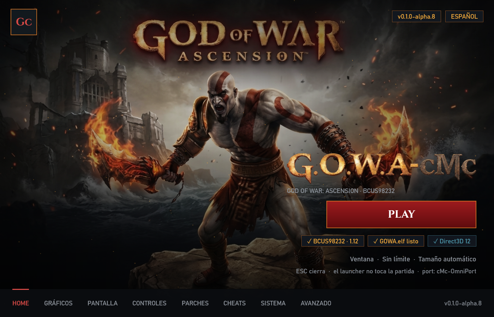
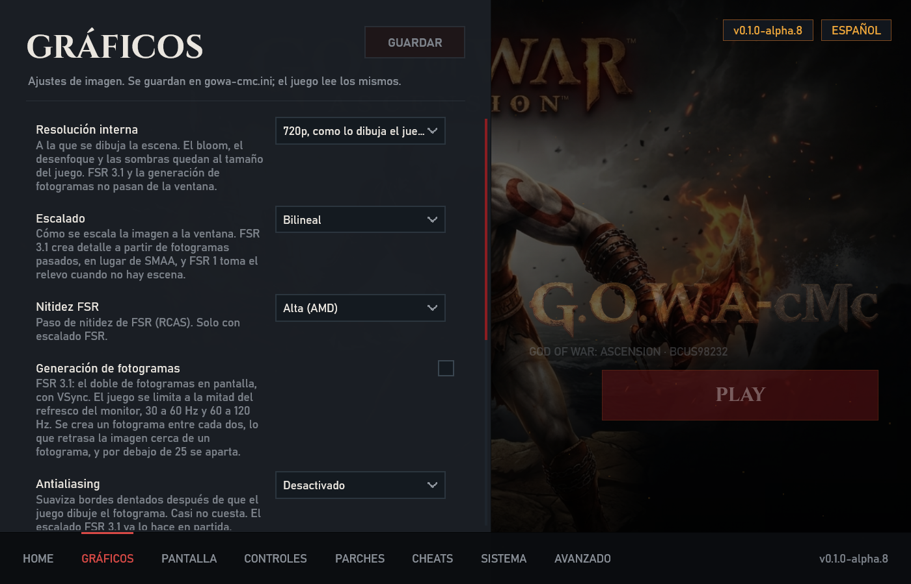
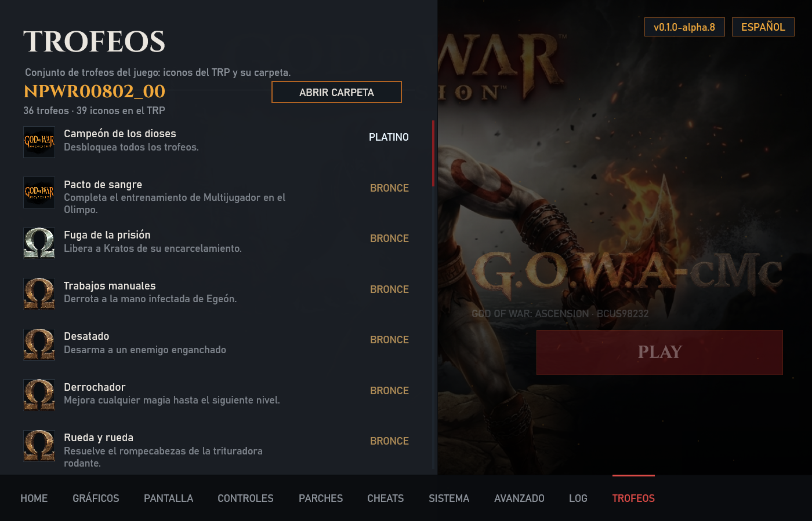
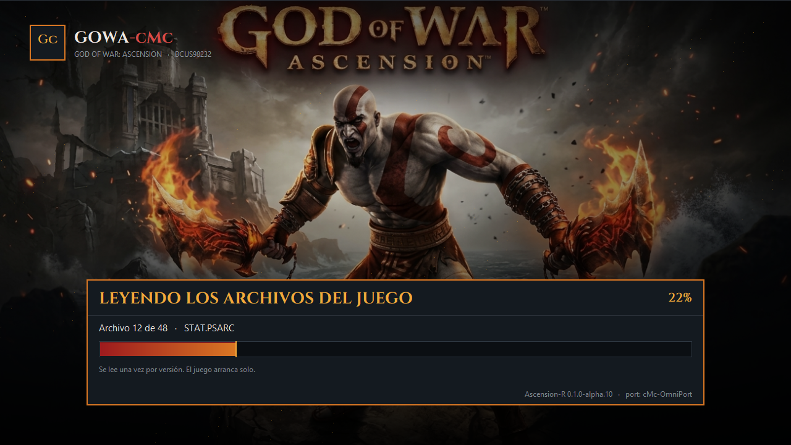

# GOWA_cMc_OmniPort

**God of War: Ascension [BCUS98232] — port nativo a Windows x64 por recompilación estática.**
Adaptación a la versión de **disco US (`BCUS98232`) v1.12** por **cMc-OmniPort (cMc292)**, sobre
**Ascension-R** de Ryan Bagas y **ps3recomp** de Ned Heller (sp00nznet) y colaboradores.

> **No incluye archivos del juego.** Necesitas tu propia copia de *God of War: Ascension* `BCUS98232` v1.12
> (disco + parches 1.04–1.12) y su `GOWA.elf` descifrado. El ejecutable contiene código traducido del juego: es una
> obra derivada y no está cubierta por la licencia MIT.

## Descargar

| Versión | Enlace |
|---|---|
| **v0.1.0-alpha.10** (actual) | [Notas de la versión](https://github.com/cMc292/GOWA_cMc_OmniPort/releases/tag/v0.1.0-alpha.10-bcus) · [Descargar ZIP](https://github.com/cMc292/GOWA_cMc_OmniPort/releases/download/v0.1.0-alpha.10-bcus/GOWA_cMc_OmniPort-0.1.0-alpha.10-release.zip) |
| Todas | [Página de releases](https://github.com/cMc292/GOWA_cMc_OmniPort/releases) |

## Capturas

## Enlaces

- **Repositorio y documentación:** https://github.com/cMc292/GOWA_cMc_OmniPort
- **Cambios de cada versión:** [docs/CHANGELOG.md](https://github.com/cMc292/GOWA_cMc_OmniPort/blob/main/docs/CHANGELOG.md)
- **Problemas y reportes:** https://github.com/cMc292/GOWA_cMc_OmniPort/issues
- **Motor original:** [Ascension-R](https://github.com/rigaz29/Ascension-R) · [ps3recomp](https://github.com/sp00nznet/ps3recomp)

*God of War* es una marca de **Sony Interactive Entertainment LLC / Santa Monica Studio**. Proyecto de aficionados,
sin ánimo de lucro, **no afiliado** a Sony.
